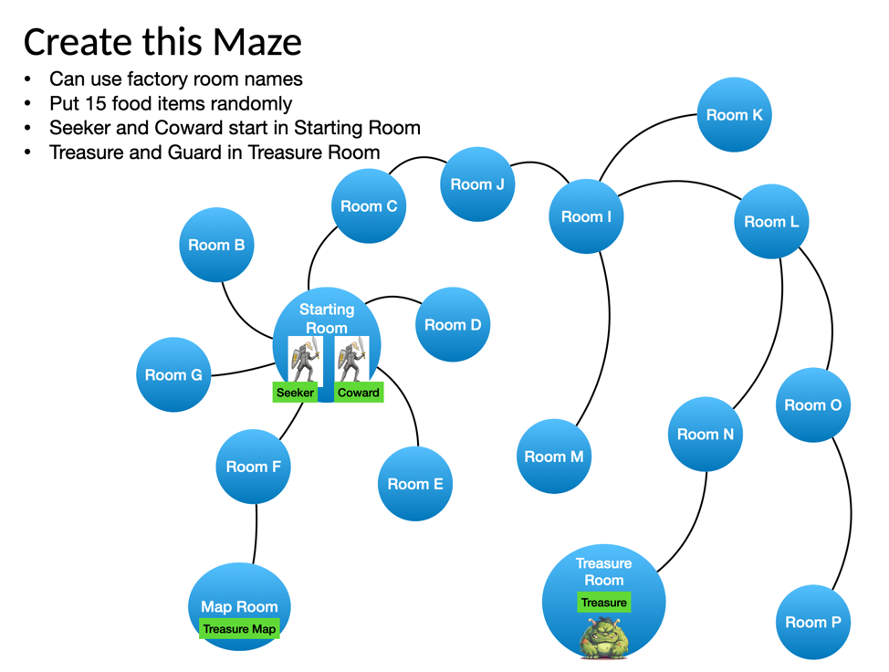
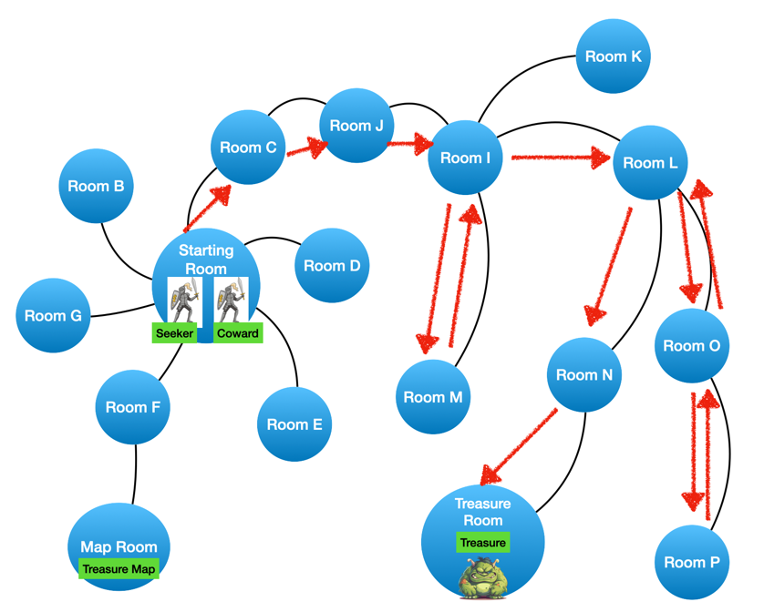

# Polymorphia Homework Sequence

Put all team members' names here:

    Names: Nathnael Tewelde, Ziyou Wu
    Java Version: 25
    Test Coverage Screenshot pasted below:
    ______________________________________
    Path Seeker took to the Treasure (rooms visited in sequence):
    Seeker moved from Starting to C
    Seeker moved from C to J
    Seeker moved from J to I
    Seeker moved from I to K
    Seeker moved from K to I
    Seeker moved from I to M
    Seeker moved from M to I
    Seeker moved from I to L
    Seeker moved from L to O
    Seeker moved from O to P
    Seeker moved from P to O
    Seeker moved from O to L
    Seeker moved from L to N
    Seeker moved from N to Treasure

    Seeker reached the Treasure room but died fighting the guard.
    The game ended after 27 turns with the creatures winning.
    
    Game Output pasted below (or linked): 
Game Output: [View treasure hunt output](src/output.txt)
    
    Test ran to produce the output below: RunCucumberTest.java
    ______________________________________

# Homework 7: Adding an EventBus, an AudibleObserver, and a TestObserver

## Use the Singleton Pattern to implement an Event Bus that "catches" events. The Event Bus will
notify any listeners/subscribers/observers that are interested. The catch is that observers are
only interested in observing Polymorphia -- they know nothing about an Event Bus.

To keep our Polymorphia class clean, add your observer pattern to a subclass
called ObservablePolymorphia. 

## Create an Audible Observer
Create an observer that can subscribe to certain events in Polymorphia, like Death, Fight,
or End of Game and when they occur, the event is announced over your laptop's speaker.

## Create a Test Observer
Create an observer that can subscribe to all events in Polymorphia. This observer merely records
that the events occurred so that later step defs can query the observer about an event occurring.

Create a new Gherkin step "a fight occurred" and implement the step definition. Then use it to replace
any Gherkin step that was previously used to confirm a fight occurred. And use it in addition to any
Gherkin steps that are checking the health of character after a fight has assumed to happen.

Create a new scenario with three creatures where the adventurers are guaranteed to win by killing all the
creatures and confirm that three deaths have occurred using this new Test Observer.

Consider where the code be for a Test Observer should be.

## New Game Play Features

Add a new Die artifact to the Maze. Make a method that can construct a random n-sided die and use
the Maze Builder to place it in a room. Update the Strategy of your choice to look for such an artifact
and pick it up. Once it is picked up, it should replace the character's previous die. 

## New Scenario to Write and Run

Create a new scenario, in a new file, that creates this maze and plays the game.
Run it enough times so that the Seeker or Coward finds his way to the 
Treasure. Set the initial health of both characters to 5.0. 
Adjust the Seeker behavior to eat, if possible, if their health gets below 2.5.

To achieve this, you will probably need to write a new step def or two, but most of this already
exists. I did it by adding a single line to a step def file.

Record the path taken by the Seeker or Coward at the top of this file.
Either with text like this example:

    Seeker moved from Starting to C
    Seeker moved from C to J
    Seeker moved from J to I
    Seeker moved from I to M
    Seeker moved from M to I
    Seeker moved from I to L
    Seeker moved from L to O
    Seeker moved from O to P
    Seeker moved from P to O
    Seeker moved from O to L
    Seeker moved from L to N
    Seeker moved from N to Treasure

Or by showing the path on the diagram like this:

## Hints

Write a test for your Audible Observer, but once you confirm that it is working, mark it was @Disabled,
as we don't want such tests to run automatically in our test suite since this requires a user to validate
that it is working. This will be a manual test for us.

## Rubric

**70 total points**:

* Event Bus implemented with the Singleton Pattern: 10 points
* Observer Pattern on ObservablePolymorphia; observers know nothing about the Event Bus: 10 points
* Events broadcast for (at least) fights, deaths, and the end of the game: 6 points
* Audible Observer announces the events it subscribes to, with a manual (@Disabled) test: 8 points
* Test Observer records events and is queried by the step defs: 6 points
* "a fight occurred" step def, used in place of and alongside the existing fight checks: 8 points
* Scenario with three creatures confirming three deaths through the Test Observer: 5 points
* Die artifact: created by a factory method, placed with the Maze Builder, picked up by a strategy,
  replaces the character's die, and covered by a test: 10 points
* Treasure-hunt scenario in a new feature file, Seeker eats when health drops below 2.5, and the path and game
  output recorded at the top of this README: 7 points

For all code submissions, the following will be required:

* The project builds with Gradle and runs successfully
* All BDD tests pass
* Adding any assumptions about your implementation in this README.md file. If anything
  isn't specified to your satisfaction in the homework description, that means you
  are free to decide for yourself. Just make sure to document your assumptions here.

This is a group assignment, as will be all the remaining homework assignments.
You will submit a URL to your GitHub Classroom repository.

# Submission and Grading

The submission will be a URL to the GitHub repository. The repository should contain well-structured OO Java
code for the Polymorphia simulation, the two captured text files with the program results requested,
and a README file that has the names of the team members, the Java version,
and any other comments on the work – including documenting any assumptions or interpretations of the problem.
Only one URL submission is required per team.

## GitHub Guidelines

All code submissions for this course will be managed through GitHub Classroom.
Since this homework is a team assignment, only one repository submission is required per team. Hence, please do the
following:

* TEAM-MEMBER-1 generates the repository.
* TEAM-MEMBER-1 adds TEAM-MEMBER-2 as a collaborator with write permissions.

ONLY ONE of the team members submits the repository link in Canvas. You'll both get credit for the submission.

Please do not make the repositories public since this violates the Honor Code.
Please note that repositories not established using the GitHub Classroom link will not be considered valid for
submission.

Please contact the class staff if you encounter technical difficulties or have questions about the setup process.

## Overall Project Guidelines

Assignments will be accepted late for one day only with a penalty of 10%.
After that, assignments will be given a 0 and will not be graded.

Use office hours, e-mail, or Piazza to reach the class staff regarding homework/project questions or if you have issues
completing the assignment.

# Homework Sequence
This sequence of homework assignments is designed to
give you practice in OO design and implementation using
the four pillars of OO:

* Abstraction
* Polymorphism
* Inheritance
* Encapsulation

Along with the SOLID principles:

* Single Responsibility Principle
* Open for Extension; Closed for Modifications
* Liskov Substitution Principle (IS-A relationship)
* Interface Fidelity Principle
* Dependency Injection

Plus:

* DRY (Don't Repeat Yourself)
* KISS (Keep It Simple, Stupid)
* YAGNI (You Ain't Gonna Need It)
